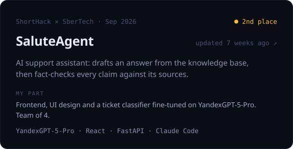
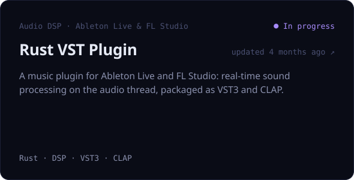

<!-- Generated by scripts/build.py from profile.json. Edit those, not this file. -->

- 🎓 First-year student at **NUST MISIS**. I live in Moscow and come from Krasnodar
- 🧠 Going deep into **machine learning**, with **Rust** as my systems language
- 🏆 **2nd place** at ShortHack × SberTech · **ICPC** 1/8 stage · prize places at **RoboFinist** 2023 and 2024
- 🎨 I design and build interfaces and look at products through a marketing-analytics lens

 

