



- 🎓 First-year student at **NUST MISIS**. I live in Moscow and come from Krasnodar
- 🧠 Going deep into **machine learning**, with **Rust** as my systems language
- 🏆 **2nd place** at ShortHack × SberTech · **ICPC** 1/8 stage · prize places at **RoboFinist** 2023 and 2024
- 🎨 I design and build interfaces and look at products through a marketing-analytics lens
- 🤖 Daily driver: **Claude Code**. I plan the work, delegate to agents and review every diff myself
- 🎯 Next goal: an ML internship in about a year


 


<a href="https://github.com/UberSpy0/VST-plugin-based-on-Rust"></a> <a href="https://github.com/UberSpy0/ML-Practice-Repo"></a>

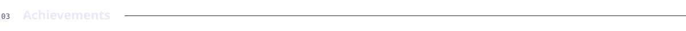

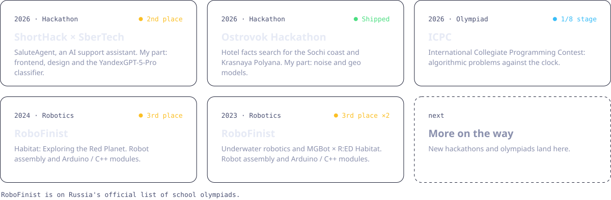



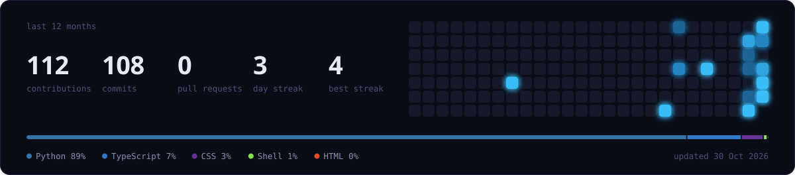



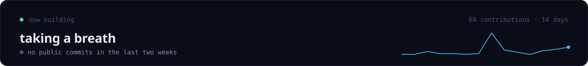

<b>Play contribution tetris</b>

 

<a href="https://t.me/fab_butt">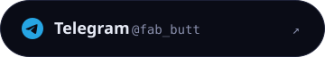</a>


